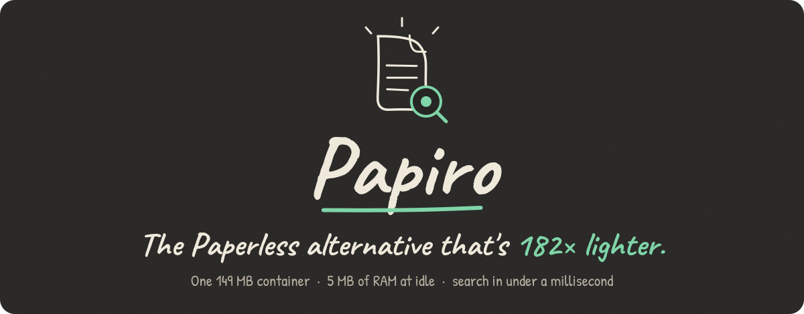
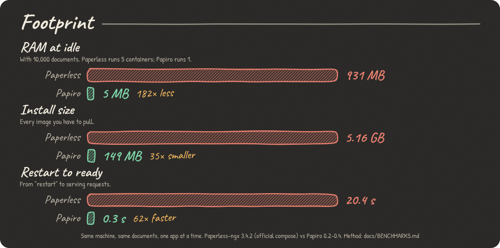
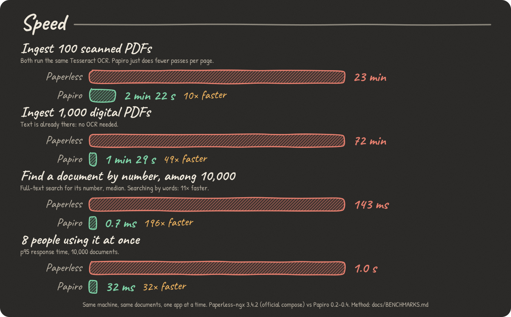
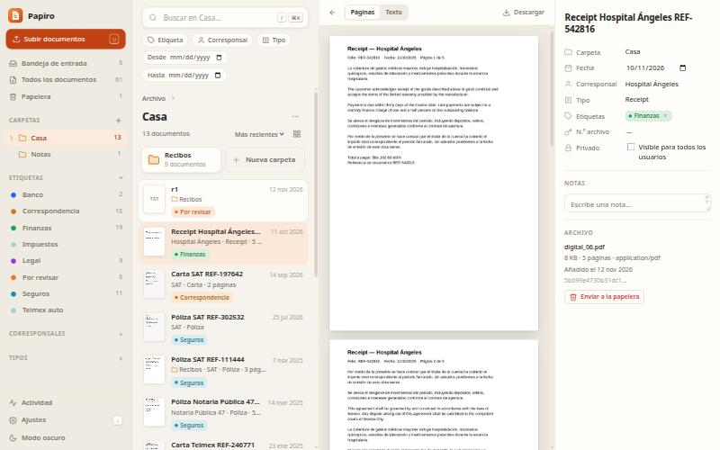
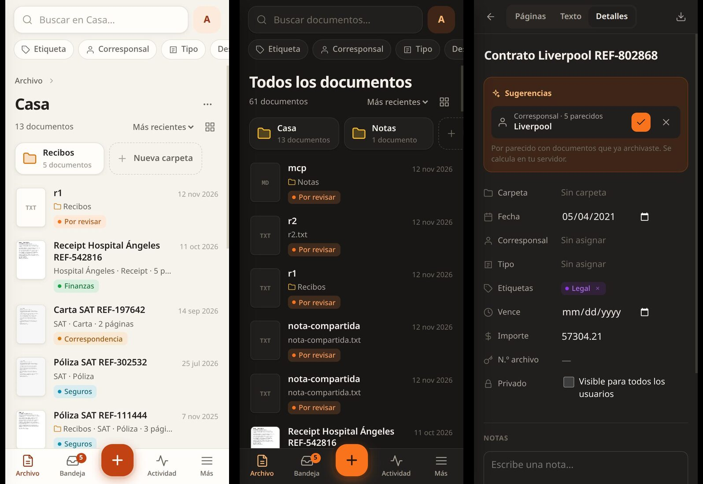

<p align="center">
  
</p>

<p align="center">
  <b>Self-hosted document archive with OCR and instant full-text search.<br>One binary. One container. One SQLite database.</b>
</p>

<p align="center">
  <a href="LICENSE"></a>
  
  <a href="https://github.com/elpablazo/papiro/pkgs/container/papiro"></a>
  
</p>

---

**Paperless-ngx** is a great idea wrapped in a lot of machinery. To sit there doing nothing, it boots a Django app five times over, keeps Redis, PostgreSQL, Tika and Gotenberg running next to it, and forks a brand-new Python process for every single document. That's **931 MB of RAM and 5 GB of images** before you've scanned a receipt.

**Papiro** does the same job in **one 149 MB container that idles at 5 MB**. Same Tesseract OCR, same "drop a PDF, find it later" workflow, and it imports your Paperless archive in one command.

| | Paperless-ngx | Papiro | |
|---|---:|---:|---:|
| RAM at idle (10,000 documents) | 931 MB | **5 MB** | **182× less** |
| Images to pull | 5.16 GB | **149 MB** | **35× smaller** |
| Restart to ready | 20.4 s | **0.3 s** | **62× faster** |
| Ingest 100 scanned PDFs (OCR) | 23 min | **2 min 22 s** | **10× faster** |
| Ingest 1,000 digital PDFs | 72 min | **1 min 29 s** | **49× faster** |
| Find a document by its number, among 10,000 | 143 ms | **0.7 ms** | **196× faster** |
| Search by words, among 10,000 | 135 ms | **12 ms** | **11× faster** |
| 8 people using it at once (p95) | 1.0 s | **32 ms** | **32× faster** |
| Same file uploaded 10 times | 10 documents | **1 document** | |
| Killed mid-OCR (API upload) | upload lost | **resumes on restart** | |

Same machine, same documents, one app at a time. Every number has a script and raw data behind it: **[docs/BENCHMARKS.md](docs/BENCHMARKS.md)**. Including the ones where Paperless wins.

<p align="center">
  
  
</p>

## What it looks like

<p align="center">
  
</p>
<p align="center">
  
</p>

> **Heads-up:** the interface is in **Spanish** for now. An English UI is the top item on the roadmap, and the most wanted contribution. The API, CLI and docs are in English.

## Quick start

```bash
docker run -d --name papiro -p 8000:8000 \
  -v papiro-data:/data -v papiro-consume:/consume \
  -e PAPIRO_ADMIN_USER=admin -e PAPIRO_ADMIN_PASSWORD=change-me-please \
  ghcr.io/elpablazo/papiro:latest
```

Open <http://localhost:8000>. Or with Compose:

```bash
git clone https://github.com/elpablazo/papiro && cd papiro
cp .env.example .env        # set the admin password
docker compose up -d
```

Without `PAPIRO_ADMIN_USER`/`PAPIRO_ADMIN_PASSWORD`, the first visit shows a setup screen. Images are published for **amd64 and arm64**.

## Coming from Paperless-ngx

```bash
# 1. In Paperless (read-only: it just exports)
docker compose exec webserver document_exporter ../export

# 2. In Papiro, with that folder mounted at /import
docker compose run --rm -v /path/to/export:/import:ro papiro import /import
```

Brings over documents (original, archived PDF and already-extracted text, so **no OCR is redone**), dates, ASNs, tags with colours, hierarchy and inbox flag, correspondents, document types with their matching rules, notes and custom fields. Storage paths become folders. Every original is checked against the manifest's SHA-256. It's idempotent: run it twice, get the same archive. At the end it lists what had no equivalent (users, permissions, saved views, workflows, mail rules).

## Why it's so much lighter

It's not "Rust is faster than Python": both call the same Tesseract for OCR. The difference is everything around it.

| | Paperless-ngx | Papiro |
|---|---|---|
| Processes | Web server, Celery worker (parent + child), scheduler, folder watcher: five long-lived Python processes, each loading all of Django | One process |
| Per document | Forks a new Python process (`max_tasks_per_child=1`): 4.3 s even for a PDF that needs no OCR | A function call: 0.05 s |
| Services | Redis/Valkey, PostgreSQL, Apache Tika (JVM), Gotenberg (Chromium + LibreOffice) | None. SQLite and its FTS5 index live inside the process |
| Office files | Sent to Tika and Gotenberg | Read directly (DOCX/XLSX/PPTX/ODT are ZIP + XML) |
| OCR pipeline | unpaper, deskew, rotation, OCR, PDF/A conversion with Ghostscript | Text layer from `pdftotext`; OCR only the pages that need it; `qpdf` overlays the text on your original without recompressing it |
| Search | Tantivy index, then the ORM, then DRF serialization | One SQLite query |
| OCR memory | As many parallel Tesseracts as cores, no cap | A fixed number (2 by default), so RAM under load is predictable |

Papiro is faster partly **because it does less**: no PDF/A, no page cleaning or deskewing. That's a real trade-off, listed below.

## Features

- **Ingest from anywhere.** Drag and drop or paste in the browser, the camera on your phone, "Share → Papiro" on Android, a watched folder (subfolders become Papiro folders), the REST API, MCP, or email over IMAP. PDF, images (PNG, JPEG, TIFF, WebP, GIF), DOCX, XLSX, PPTX, ODT, ODS, ODP, TXT, MD, CSV.
- **OCR that doesn't redo work.** Pages that already have text skip OCR. Pages scanned sideways or upside down are detected and fixed. 
- **Instant search.** SQLite FTS5 with ranking, highlighted snippets and filters by tag, correspondent, type, folder and date. Results appear as you type.
- **Folders, tags, correspondents and types.** Nested folders, drag documents onto them, bulk edit anything.
- **Local auto-filing.** Papiro suggests folder, type, correspondent and tags based on similar documents you've already filed, and finds expiry dates and amounts. **Nothing leaves your server**: no model, no API call. [How it works and how accurate it is →](docs/AUTO-FILING.md)
- **Expiry tracking.** An "expiring" view with everything that's expired or due in 60 days (IDs, insurance policies, contracts), and amounts summed over any list.
- **Phone-first and installable.** A PWA with a bottom tab bar, camera capture and the Android share sheet. Works on desktop with three panes, a command palette (`⌘K`) and keyboard shortcuts for everything.
- **Built for scripts and AI.** REST API with an OpenAPI 3.1 spec, signed webhooks with a persistent retry queue, read-only and expiring API tokens, and an **MCP server** so Claude (or any MCP client) can search, read, upload and file documents.
- **Multi-user.** Admin, editor and viewer roles, private documents, an audit log.
- **Your documents stay safe.** See below.

## Your documents are safe

- **Atomic ingest.** A document only exists once its database row and its files are both complete: files are staged, the copy's SHA-256 is verified, and the folder is moved into place inside the same transaction that inserts the row. Kill it with SIGKILL at any point and it either finishes on restart or never happened. Tested at seven different moments, including mid-copy of a 161 MB file.
- **Failures keep the file.** A failed job keeps its upload and can be retried from the Activity panel (or `POST /api/jobs/{id}/retry`).
- **Daily verification.** Every document is checked against its SHA-256. Results in Settings → Health and in `papiro verify`.
- **Backups with history.** Set `PAPIRO_BACKUP_DIR` and Papiro backs itself up every day, incrementally, while running, keeping a daily copy of the database for 14 days. `papiro restore <dir> YYYY-MM-DD` brings back any of those days.
- **No lock-in.** `papiro export <dir>` writes every document with a human-readable name plus a `manifest.json`. You don't need Papiro to read your archive.
- **Versioned schema.** Migrations run in a transaction after backing up the database. An old binary refuses to open a newer database instead of corrupting it.

```bash
docker compose exec papiro papiro backup /backup     # back up now
docker compose exec papiro papiro verify             # check every document
docker compose exec papiro papiro export /backup/plain   # plain files + manifest.json
docker compose run --rm -v /path/to/backup:/backup:ro papiro restore /backup              # into an empty data volume
docker compose run --rm -v /path/to/backup:/backup:ro papiro restore /backup 2026-11-10   # that day's database
```

## Where Paperless-ngx is still better

Being honest is part of the pitch:

- **PDF/A** archival output. Papiro keeps your original and overlays a text layer.
- **Page cleaning and deskewing** before OCR. On a page skewed 4°, Paperless read 100 % of the words and Papiro 96.7 %; on a dim photo with a shadow, 62 % vs 53 %.
- **Workflows** (triggers and actions), **mail rules**, **group permissions**, saved views, share links, barcodes and document splitting, MFA/SSO.
- **A machine-learning classifier** trained on your archive. Papiro's local auto-filing is similarity-based and simpler.
- **37 UI languages.** Papiro's UI is Spanish-only today.
- **Years in production** and a big community. Papiro is young.

## Install on your phone

Papiro is an installable web app. It needs HTTPS (or `localhost`).

- **Android (Chrome):** menu → *Install app*, or **Más → Instalar Papiro** inside the app. It then shows up in every app's share sheet.
- **iPhone / iPad (Safari):** Share → *Add to Home Screen*. iOS doesn't let web apps receive shared files; use the **+** button.

Offline, the app opens and says so, but doesn't show documents: they live on your server and Papiro keeps no copies on the phone.

## Configuration

Everything is an environment variable. No secret lives in the code or the image.

| Variable | Default | What it does |
|---|---|---|
| `PAPIRO_ADMIN_USER`, `PAPIRO_ADMIN_PASSWORD` | — | Create the admin on first start |
| `PAPIRO_DATA` | `/data` | SQLite database and files |
| `PAPIRO_CONSUME` | `/consume` | Watched folder (empty disables it) |
| `PAPIRO_CONSUME_INTERVAL` | `5` | Seconds between folder scans |
| `PAPIRO_LISTEN` | `[::]:8000` | Listen address |
| `TZ` | `UTC` | Time zone for default document dates |
| `PAPIRO_BACKUP_DIR` | — | Folder for **automatic backups** (ideally another disk). Unset means no automatic backups |
| `PAPIRO_BACKUP_HOURS` | `24` | Hours between backups |
| `PAPIRO_BACKUP_KEEP` | `14` | Daily database copies to keep (`0` = only the latest) |
| `PAPIRO_VERIFY_HOURS` | `24` | Hours between integrity checks (`0` = never) |
| `PAPIRO_TRASH_DAYS` | `0` | Empty the trash after this many days (`0` = never) |
| `PAPIRO_OCR_LANGS` | `spa+eng` | Tesseract languages. Must be in the image: build with `--build-arg OCR_LANGS="eng deu fra"` |
| `PAPIRO_WORKERS` | `1` | Documents processed at once |
| `PAPIRO_OCR_THREADS` | `min(CPUs, 2)` | Pages OCR'd at once per document. **This is the RAM knob under load**: ~100–150 MB each while running |
| `PAPIRO_OCR_DPI` | `300` | Max rasterization DPI (the scan's native DPI is used if lower) |
| `PAPIRO_OCR_ROTATE` | `true` | Detect and fix pages scanned sideways or upside down |
| `PAPIRO_OCR_ROTATE_BELOW` | `75` | Mean OCR confidence below which orientation is checked |
| `PAPIRO_OCR_ARGS` | — | Extra Tesseract arguments |
| `PAPIRO_CMD_TIMEOUT` | `600` | Seconds allowed per external tool |
| `PAPIRO_MAX_UPLOAD_MB` | `512` | Max upload size |
| `PAPIRO_GOTENBERG_URL` | — | Optional Gotenberg to convert Office files to PDF (adds DOC, XLS, PPT, RTF and PDF previews) |
| `PAPIRO_WEBHOOK_ALLOW_PRIVATE` | `false` | Allow webhooks to private/internal addresses |
| `PAPIRO_LLM_API_KEY` | — | Enables optional LLM classification and summaries. **Sends document text to the provider** |
| `PAPIRO_LLM_PROVIDER` | `anthropic` | `anthropic` or `openai` (any `/chat/completions` API: Ollama, OpenRouter…) |
| `PAPIRO_LLM_MODEL` | `claude-opus-5-5` | Model. `claude-haiku-5-5` is the cheap option |
| `PAPIRO_LLM_BASE_URL` | per provider | For proxies or local models |
| `PAPIRO_LLM_AUTO` | `false` | Classify every new document automatically |
| `PAPIRO_IMAP_HOST`, `_PORT`, `_USER`, `_PASSWORD`, `_FOLDER`, `_INTERVAL` | — / 993 / … / `INBOX` / 300 | Email ingestion |

## Users and permissions

| Role | Can |
|---|---|
| **Admin** | Everything, plus permanent deletion, users, webhooks, Health and Audit |
| **Editor** | Upload, edit, tag, move to trash, restore |
| **Viewer** | Search, read, download |

- A **private** document is visible only to its uploader and admins: not in lists, search or MCP for anyone else.
- API tokens can be **read-only** and **expiring**.
- Logins, uploads, edits, deletions and admin changes are written to an **audit log** with user and IP.
- Login is throttled to 10 attempts per 5 minutes **per IP**, so nobody can lock you out by failing your password.

## API

- Spec: `GET /api/openapi.json` (OpenAPI 3.1, generated from the code), browsable in Settings → API.
- Auth: `Authorization: Bearer ppr_…` (create tokens in Settings → Tokens and MCP).
- Errors are always `{"error": "message"}` with the matching HTTP status.

```bash
# Upload and get the processed document back in the same call
curl -H "Authorization: Bearer $TOKEN" -F file=@invoice.pdf "http://localhost:8000/api/documents?wait=true"

# Search with filters
curl -H "Authorization: Bearer $TOKEN" "http://localhost:8000/api/documents?q=electricity&from=2025-01-01&tags=3"

# Bulk edit: same fields as editing one document, in one transaction
curl -H "Authorization: Bearer $TOKEN" -H 'Content-Type: application/json' \
  -d '{"ids":[1,2,3],"add_tags":[5],"folder_id":2}' http://localhost:8000/api/documents/bulk
```

**Webhooks:** `POST /api/webhooks` with `{"url", "events", "secret"}`. Events: `document.created`, `document.updated`, `document.deleted`, `document.purged` (or `*`). Deliveries are queued in the database, survive restarts and are retried up to 6 times with growing back-off. With a secret, each one carries `X-Papiro-Signature: sha256=<HMAC-SHA256 of the body>`.

**MCP:** a Streamable HTTP server at `/mcp`, same bearer token. Tools: `search_documents`, `get_document`, `list_metadata`, `update_document`, `upload_document`. A read-only token can only search and read.

```bash
claude mcp add --transport http papiro https://your-domain/mcp --header "Authorization: Bearer ppr_…"
```

## How it's built

```
src/main.rs     config, CLI, HTTP server, embedded UI, maintenance (backups, verification)
src/db.rs       SQLite + FTS5 schema and versioned migrations, one connection per thread (WAL)
src/store.rs    documents, folders, labels, search, events (SSE + webhooks), audit
src/ingest.rs   durable job queue, watched folder, text extraction and OCR, atomic storage
src/suggest.rs  local auto-filing: rules and similarity
src/api.rs      REST API with OpenAPI annotations
src/auth.rs     users, sessions, tokens, roles, throttling
src/mcp.rs      MCP server
src/import.rs   Paperless-ngx importer
src/backup.rs   backup, restore and export
web/            UI: Preact + htm, no build step, embedded in the binary
```

A PDF goes through `pdftotext` for any existing text; only pages without text are rasterized at their native resolution and sent to `tesseract`; `qpdf` overlays the invisible text layer on your original PDF without recompressing its images; then a thumbnail. Images go straight to Tesseract. Office documents are read natively.

## Development

```bash
cargo test                       # unit tests
PAPIRO_WEB_DIR=web cargo run     # serve the UI from disk: edit web/ and reload
```

Needs `tesseract`, poppler-utils (`pdftotext`, `pdftoppm`, `pdfinfo`, `pdfimages`) and `qpdf` on the `PATH`; the Docker image has them. Benchmarks and their scripts are in [`bench/`](bench/). See [CONTRIBUTING.md](CONTRIBUTING.md).

## Roadmap

- English UI (i18n)
- Multi-page scanning from the phone camera into one PDF, with edge detection
- Deskewing and contrast cleanup before OCR
- Expiry reminders (calendar feed and push notifications)
- PDF/A output

## License

[MIT](LICENSE). Papiro is not affiliated with the Paperless-ngx project; it's an independent rewrite that reads its export format.
